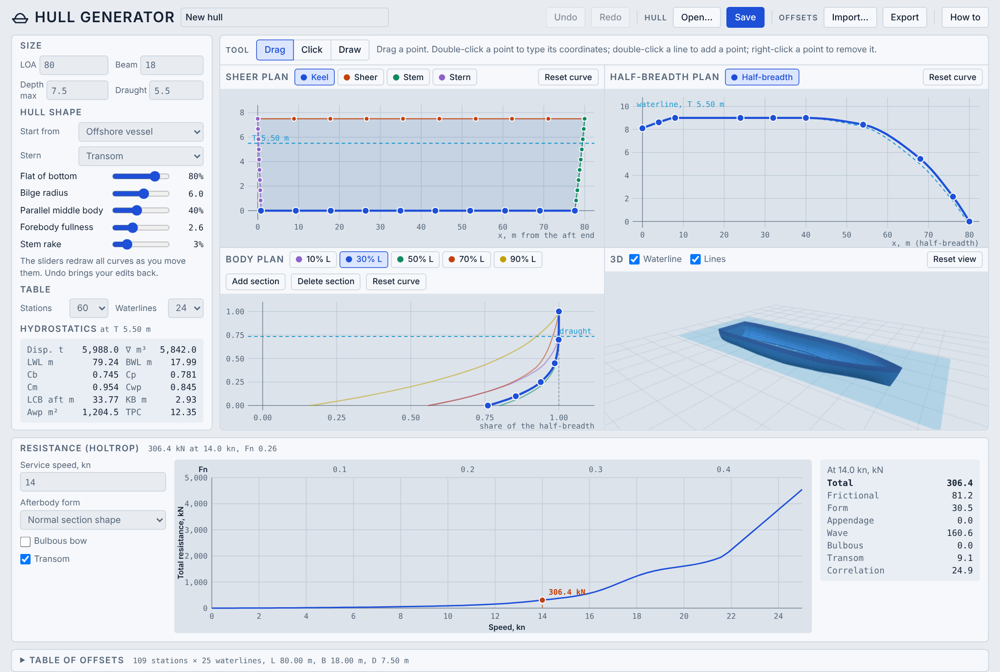

# Hull Generator

**Open the app: https://shiplab.github.io/hull/**

A browser app that makes a hull form quickly. You start from a basic hull type and a few dimensions, then reshape it by editing curves in three linked 2D views, with a live 3D hull beside them. It reads the hydrostatics and a Holtrop resistance estimate from the hull as you edit, and gives a table of offsets that you can copy or save, for example for the [Ship Design Building Block Editor (DBB)](https://shiplab.github.io/dbb/).

It is one HTML file. It needs no installation, no server and no internet connection once the page is loaded. Nothing you draw leaves your computer.

Made for teaching and early concept exploration. Educational use only (see [Limits](#limits)).

## What it does

- **Start from a hull.** Six starting hulls: cargo ship, offshore vessel, research vessel, workboat, slender hull and barge. Set LOA, beam, depth max and draught, and choose a transom, round or cruiser stern.
- **Shape sliders.** Flat of bottom, bilge radius, parallel middle body, forebody fullness and stem rake. They redraw all curves as you move them.
- **Edit the curves.** Three linked views: the sheer plan (keel, sheer, stem, stern), the half-breadth plan (the outline from above) and the body plan (the cross-sections). Every edit updates the other views, the 3D hull and the hydrostatics at once.
- **Body plan sections.** Five sections to start, from 2 to 20. Add a section, delete one, and type the position of a section in % of the length.
- **3D view.** Orbit, pan and zoom. Shows the waterline and the lines (stations and waterlines). The deck is left open so you can see inside the hull.
- **Hydrostatics.** Displacement, volume, LWL, BWL, Cb, Cp, Cm, Cwp, LCB, KB, waterplane area and TPC, at the chosen draught, read from the table of offsets the same way DBB reads it.
- **Resistance (Holtrop).** The total resistance against speed, with the Froude number along the top, a marker at the service speed and the parts of the resistance at that speed. See [Resistance](#resistance-holtrop).
- **Table of offsets.** Choose the number of stations and waterlines. Export it to copy or to save as CSV, or import a table and turn it into curves you can edit.
- **Hull file.** Save the hull with all its curves (JSON) and open it again later. Undo and redo.

## How to use it

1. **Start from a hull.** Pick a type in *Start from* and set the main dimensions. Moving a slider or changing the stern replaces the curves you edited by hand. Undo brings them back.
2. **Shape the curves.** Choose a curve with the buttons above a view and edit it with one of three tools:
   - *Drag* moves a point. Double-click a point to type its exact coordinates. Double-click a line to add a point. Right-click a point to remove it.
   - *Click* adds a point where you click.
   - *Draw* replaces the selected curve with a smooth fit of a freehand line.

   A curve can have up to 24 points. Each starts with 10.
3. **Sections.** In the body plan, *Add section* puts a new section in the biggest gap. Click a selected section a second time to type its position.
4. **Check the hull.** Read the hydrostatics on the left. Open *Table of offsets* at the bottom to see the table.
5. **Resistance.** The Resistance panel is always open. Set the service speed, the afterbody form, and whether the hull has a bulbous bow and a transom.
6. **Save or export.** *Save* writes the hull (JSON). *Export* shows the table of offsets, ready to copy or to download as CSV.

The *How to* button in the app has the same steps, the keyboard and mouse shortcuts, and a glossary.

### Shortcuts

| Key or mouse | Action |
| --- | --- |
| Ctrl+Z | Undo |
| Ctrl+Shift+Z or Ctrl+Y | Redo |
| Delete or Backspace | Remove the selected point |
| Double-click a point | Type its exact coordinates |
| Double-click a line | Add a point |
| Right-click a point | Remove it |
| Click a selected section again | Type its position in % of the length |
| Drag in the 3D view | Orbit (right-drag pans, the wheel zooms) |

On a Mac, use Cmd in place of Ctrl.

## Files

### Hull file (JSON)

The main format. It keeps the curves, so you can edit the hull again. Use *Save* and *Open…*.

### Table of offsets (CSV)

For use in other tools. *Export* shows the table to copy or download. *Import…* reads a table from a file or from pasted text and turns it into curves.

- The first row holds the station positions x, in metres, from the aft end. The first column holds the heights z, in metres, above the baseline. The corner cell is `z_m \ x_m`.
- The cells are half-breadths in metres. A blank cell means there is no hull there.
- Separators can be commas, semicolons or tabs.

This is the layout that DBB reads. In DBB, choose *Hull from table…*, paste the table or open the CSV, then set the depth and draught.

An imported table becomes a close copy, not an exact one: the curves are fitted to it, and the app shows the volume difference after the import.

### Conventions

Metres. x forward from the aft end of the hull, y to port (half-breadths are positive), z up from the baseline, the lowest point of the keel. The hull is symmetric about the centreline. These are the conventions of DBB.

## Resistance (Holtrop)

The Resistance panel estimates the total resistance of the hull at speeds up to about Froude number 0.45, using the Holtrop method for displacement ships. The method is based on regression of model tests and ship trials. It is for a first estimate and for comparing designs.

- **Inputs from the hull.** LWL, BWL, Cb, Cm, Cwp and LCB (in % of LWL, forward of midship), read from the table of offsets at the current draught. The same draught is used forward and aft.
- **Inputs in the panel.** Service speed in knots, the afterbody form (pram with gondola, V-shaped sections, normal, or U-shaped with Hogner stern), a bulbous bow (off by default, since the hulls drawn here have no bulb) and a transom (it follows the stern type).
- **Result.** The plot of total resistance in kN against speed, with the service speed marked. The table gives the total and the frictional, form, appendage, wave, bulbous, transom and correlation parts at the service speed. Appendages are not included.
- **Warnings.** The app warns when L/B (3.9 to 15), B/T (2.1 to 4) or Cp (0.55 to 0.85) are outside the range of the method, and says when the method does not cover a hull.

The formulation is a port of the ShipLab Holtrop web app (Flor, Monteiro and Gaspar), including its approximations for the transom area, the bulb area and the correlation term. The port was checked against that page for ten cases, and the results are the same at every speed from 0 to 40 knots.

## Limits

This tool is made for teaching and for early concept exploration.

- The hull forms are illustrative, not fair lines. The table is sampled from smooth curves.
- The hydrostatics are simple estimates read from the table.
- The Holtrop result is an estimate for comparing designs. It is less accurate for extreme shapes, and the wave term grows quickly at high speed.
- The results must not be used for design approval, class or flag-state documentation, or any safety-critical decision. The software is provided as it is, without warranty.

## Browsers

Current Chrome, Edge, Firefox and Safari. The 3D view needs WebGL. The page follows the light or dark setting of your system.

## Technical notes

- One file, `index.html`, with the styles, the page and [Three.js](https://threejs.org/) r147 (MIT license) inlined.
- Curves are monotone cubic (PCHIP) with constant extrapolation. The half-breadth at a position is the width from the half-breadth plan times the shape from the body plan, blended between sections.
- The table of offsets is built on a uniform grid of stations, plus extra stations at the exact stem and stern of every waterline so the ends are smooth.

## Credits and citing

Developed by Henrique Gaspar, NTNU, October 2026. The Holtrop formulation follows the ShipLab Holtrop web app by Jefferson Flor, Thiago Gabriel Monteiro and Henrique M. Gaspar.

Gaspar, H.M. (2026). *Hull Generator* [Computer software]. NTNU. https://shiplab.github.io/hull/
